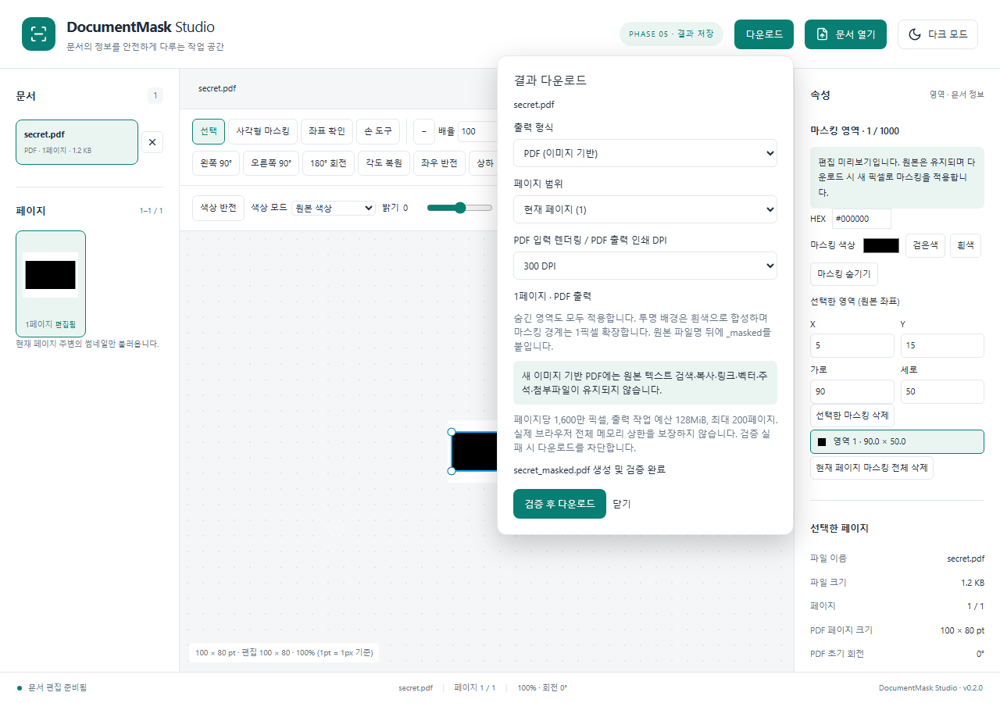

# DocumentMask Studio

React + TypeScript 기반 브라우저 문서 편집 및 영구 마스킹 프로젝트입니다. 원본 파일을 서버에 업로드하지 않는 구조를 목표로 합니다.

현재 **Phase 5 결과 저장**까지 구현했습니다. 이미지와 다중 페이지 PDF/TIFF 탐색, 확대·이동·회전·반전·색상 처리, 마스킹 영역 편집과 Undo/Redo를 지원합니다. 다운로드 시 원본을 수정하지 않고 새 픽셀에 불투명 마스킹을 합성해 PNG/JPEG/PDF/TIFF 또는 페이지 이미지 ZIP으로 저장합니다.

PDF.js, UTIF Worker, Konva/react-konva를 공통 문서 어댑터 구조로 연결했습니다. 원본 크기와 화면 미리보기를 분리하고 필요한 페이지만 렌더링합니다. 파일을 닫거나 업로드를 취소할 수 있으며 오류가 난 파일이 있어도 나머지 파일을 계속 엽니다.

## 실행

Node.js 24와 npm을 권장합니다.

```sh
npm ci
npm run dev
```

```sh
npm run typecheck
npm run lint
npm run format:check
npm test
npm run build
npm run preview
```

PDF.js의 폰트/CMap/WASM/ICC 자원은 predev/prebuild에서 설치된 패키지로부터 자동 복사합니다. worker와 모든 문서 리소스는 로컬 사이트에 포함하며 CDN을 사용하지 않습니다.

## 지원 범위 및 제한

- 파일당 100MiB, 열린 파일 총 200MiB, 최대 50문서/문서당 5,000페이지입니다. 이미지/TIFF는 페이지당 1,600만 픽셀과 한 변 16,384 제한을 검사합니다.
- GIF는 첫 프레임만 표시합니다. PDF 암호 입력은 제공하지 않고 보호된 파일에 해제 안내를 표시합니다.
- TIFF는 classic strip 기반 무압축, CCITT G3/G4, LZW, Deflate, PackBits를 지원합니다. BigTIFF, tile, 16bit, planar-separated 및 JPEG-in-TIFF 등은 아직 지원하지 않습니다. 테스트한 fixture 범위 밖의 변형은 실패할 수 있습니다.
- SVG/HEIC/AVIF/ICO는 미지원입니다. JPEG 크기 헤더는 첫 1MiB까지 검사하며 확인할 수 없는 파일은 거부합니다.
- 썸네일은 현재 페이지 주변 최대 7개, 160px로 표시합니다. 화면 미리보기는 최대 1,800px이며 원본 출력 해상도를 뜻하지 않습니다.
- 테마와 열린 파일은 새로고침 후 초기화됩니다. 테스트 브라우저는 Windows Edge 및 Playwright Chromium이며 다른 브라우저와 대용량 코퍼스 검증은 남아 있습니다.

## 브라우저 자동 테스트

Windows에서는 설치된 Microsoft Edge를 사용합니다. Linux/macOS에서는 `npx playwright install chromium`으로 테스트 브라우저를 준비하세요. fixture는 코드로 생성하므로 민감한 실제 문서가 필요하지 않습니다.

```powershell
$env:VITE_BASE_PATH = '/MaskingViewer/'
npm run build
npm run test:e2e
Remove-Item Env:VITE_BASE_PATH
```

단위 테스트 150개와 Windows Chromium production 서브경로 E2E 26개, Edge 26개를 검증했습니다. 기존 입력/탐색/편집/Worker 회귀에 더해 HiDPI 2배 마스킹 생성/이동/resize, gesture 단위 Undo, 삭제/색상/숨김, 원본 좌표·경계·취소, PDF 초기 회전 및 PDF/TIFF 페이지별 상태, 모바일을 검사합니다. 출력 파일의 실제 픽셀 및 PDF 텍스트·주석·첨부·원본 metadata·숨김 레이어 제외를 재현 fixture로 검사합니다. 모든 파일/브라우저 또는 모든 복구 공격에 대한 절대적 보안 보장은 아닙니다.



## 구조

`src/app`: 애플리케이션과 디자인 토큰, `components`: UI, `stores`: Zustand 상태, `features`: 사용자 작업, `core`: 문서/좌표/마스킹/출력 로직, `adapters`: 형식별 처리, `workers`: 비동기 처리, `tests`: 자동화 검증. 이후 단계용 디렉터리는 의도적으로 구현이 없는 경계입니다.

공통 페이지 모델로 포맷별 어댑터를 연결하고 원본 페이지 좌표에서 편집 상태를 보존합니다. ExportPanel과 ExportPipeline, 순수 픽셀 합성, 형식별 인코딩을 분리했습니다. 출력은 처리된 새 픽셀만 사용하며 PDF는 새 문서에 이미지만 삽입하므로 원본 검색·복사·링크·벡터·주석·첨부를 유지하지 않습니다.

전체 요구사항은 [PROJECT.md](PROJECT.md), 작업 상태는 [docs/PROGRESS.md](docs/PROGRESS.md), 아키텍처와 제약은 [docs/DECISIONS.md](docs/DECISIONS.md)를 확인하세요.

## GitHub Pages

`.github/workflows/pages.yml`에서 PR 검증과 main 배포를 구성했습니다. 빌드 후 Chromium 브라우저 테스트도 통과해야 배포됩니다. 원격 저장소는 연결했습니다. Settings → Pages → Source를 GitHub Actions로 설정해야 하며 실제 Pages 배포는 아직 검증하지 않았습니다.

Vite는 로컬에서 `/`, CI에서는 저장소 이름으로 계산한 base를 사용합니다. 직접 서브경로 빌드 시 PowerShell에서 다음과 같이 실행합니다.

```powershell
$env:VITE_BASE_PATH = '/MaskingViewer/'
npm run build
Remove-Item Env:VITE_BASE_PATH
```

Phase 2에서 해당 production 서브경로로 실제 PDF/TIFF/이미지 및 worker 로딩을 검증했습니다. 실제 GitHub Pages 호스팅 검증은 남아 있습니다.

## 문서 편집과 좌표

도구 모음에서 1–800% 배율을 입력한 뒤 Enter를 누르거나 화면/너비 맞춤을 선택하세요. Ctrl+휠은 포인터를 중심으로 확대하며 손 도구 드래그, 일반 휠, Shift+휠 및 뷰어에 포커스한 방향키로 이동합니다. 화면에서 보이는 방향으로 좌우/상하를 반전합니다.

색상 반전, Grayscale, 흑백(임계값 128), 밝기/대비를 독립적으로 적용할 수 있습니다. 색상 및 전체 편집 복원이 가능합니다. Ctrl+Z / Ctrl+Shift+Z / Ctrl+Y는 현재 페이지의 편집 이력을 되돌립니다. 문서/페이지 전환 시 편집은 유지되지만 새로고침 또는 문서 닫기 시 삭제됩니다.

좌표 확인 도구는 포인터의 정규화된 원본 좌표를 표시합니다. 원본 → 회전 → 화면 기준 반전 → 양수 경계 보정 → zoom/pan의 affine 행렬과 역행렬을 사용합니다. 일반 이미지/TIFF의 100%는 원본 픽셀당 CSS 1px이며 PDF는 초기 회전이 반영된 pt당 CSS 1px입니다. HiDPI backing buffer와 최대 1,800px 미리보기 해상도는 이 좌표와 별개입니다. PDF 출력은 150/300 DPI로 별도 렌더링하고 pt 좌표를 출력 raster 비율로 변환합니다. zoom/pan/DPR은 저장에 반영하지 않습니다.

색상 처리는 취소 가능한 로컬 Worker에서 새 픽셀 사본에 적용하며 thumbnail도 같은 색상/기하 커널을 사용합니다. 처리 오류 시 색상 복원으로 재개할 수 있습니다. 확대해도 미리보기의 디코딩 해상도가 자동으로 높아지지는 않습니다.

CI와 같은 bundled Chromium으로 Windows에서 브라우저 테스트를 실행할 수도 있습니다.

```powershell
npx playwright install chromium
$env:PLAYWRIGHT_CHANNEL = 'chromium'
npm run test:e2e
```

기본 Windows 실행기는 Edge이며 PLAYWRIGHT_CHANNEL=msedge로 명시할 수도 있습니다. Canvas 픽셀 검사는 Konva의 다음 프레임 그리기를 기다린 후 정확한 색상 값을 검사합니다. CI 실패 시 test-results artifact에서 스크린샷·오류 문맥·trace를 확인할 수 있습니다(7일 보관).

## 마스킹 편집

사각형 마스킹 도구로 문서 안에서 드래그하면 원본 좌표의 영역이 생성되고 선택 도구와 핸들이 활성화됩니다. 선택 도구에서 영역을 이동하거나 모서리로 크기를 바꿀 수 있습니다. 음수 방향 드래그와 모서리 교차를 정규화하고 페이지 경계를 제한합니다. 우측 목록과 X/Y/가로/세로 입력으로도 선택/수정할 수 있습니다.

검은색, 흰색, 색상 선택기 또는 6자리 HEX의 불투명 색상을 사용합니다. Delete 또는 선택 삭제, 현재 페이지 전체 삭제가 가능하며 Ctrl+Z/Ctrl+Shift+Z/Ctrl+Y로 회전·색상·마스킹의 동일한 편집 순서를 되돌립니다. 드래그는 놓는 순간 한 작업으로 기록하고 Escape/pointer 취소는 폐기합니다.

마스킹 숨김은 원본 preview 확인용입니다. 숨김 중 Canvas 편집은 차단하고 영역 데이터는 유지합니다. 전체 이미지 편집 복원도 masks를 보존합니다. 문서/페이지 전환 시 영역은 유지되며 닫기/새로고침 시 초기화됩니다. 페이지당 영역 1,000개, 가로/세로 최소 원본 기준 1단위, 이력 100개입니다. 작은 영역은 확대 또는 좌표 입력으로 수정하세요.

Canvas와 썸네일은 편집 미리보기이며 원본 파일의 정보는 유지합니다. 다운로드 시 숨긴 영역도 새 픽셀에 반영하고 출력 파일을 검증합니다. 원본 파일을 공유하는 대신 생성된 _masked 결과 파일을 사용하세요.

문서용 화면은 기존 PDF/TIFF E2E에서 실제 gesture로 재현할 수 있습니다(서브경로 build 후 실행).

```powershell
$env:PLAYWRIGHT_CHANNEL = 'chromium'
$env:CAPTURE_PHASE4 = '1'
npm run test:e2e -- e2e/masking.spec.ts --grep 'PDF and TIFF'
Remove-Item Env:CAPTURE_PHASE4
```

## 결과 저장과 검증

상단 **다운로드**에서 형식, 현재/전체 페이지, PDF 입력 렌더링 및 PDF 출력 인쇄 DPI를 선택한 뒤 **검증 후 다운로드**를 누르세요. 지원되는 PNG/JPEG/PDF/TIFF 입력은 같은 출력 형식이 기본값이고 BMP/GIF/WEBP 입력은 PNG가 기본입니다. PNG/JPEG 여러 페이지는 page_0001 등의 이미지 ZIP, PDF/TIFF는 하나의 다중 페이지 파일입니다. 파일명은 원본 이름 뒤에 `_masked`를 붙이고 실제 형식의 확장자를 사용합니다.

일반 이미지/TIFF는 원본 픽셀 크기를 유지합니다. PDF 입력은 초기 회전이 반영된 페이지를 150/300 DPI로 다시 렌더링하며, PDF 출력의 물리 크기는 pt 크기를 유지합니다. 이미지에서 PDF로 변환할 때는 선택 DPI가 인쇄 크기를 결정합니다. 저장은 새 픽셀 버퍼의 색상 처리 → 흰색 배경 불투명 합성 → 바깥 방향 반올림/사방 1픽셀 여백 마스킹 → 보간 없는 회전/반전 순서입니다. 투명 배경은 흰색으로 바뀌며 투명 픽셀의 숨은 RGB도 보존하지 않습니다. 안전 여백으로 미리보기보다 1픽셀 더 덮일 수 있습니다.

PNG는 재디코딩 후 전체 RGBA를 정확히 비교합니다. JPEG는 제거된 픽셀을 품질 0.98로 압축하지만 단색/경계가 변할 수 있으며, 크기/불투명/마스킹 영역의 채널 오차 최대 64를 검사합니다. 정확한 단색 출력은 PNG/PDF/TIFF를 사용하세요. PDF는 원본 객체를 복사하지 않고 새 문서를 만들며, 저장 후 이미지 RGB 전체를 추출·비교하고 원본 font/주석/첨부/추가 동작/metadata/숨김 레이어 구조가 없는지 확인합니다. PDF.js E2E는 원본의 검색 가능한 민감 문자열·주석·첨부 존재와 결과에서의 제거를 비교합니다.

TIFF 출력은 classic little-endian RGB 8bit, 무압축, 페이지별 단일 strip, orientation 1의 단일/다중 페이지 형식입니다. 원본 압축·EXIF·DPI metadata는 보존하지 않으며 결과가 더 커질 수 있습니다. UTIF로 재개방해 모든 페이지의 전체 픽셀과 순서를 비교합니다. ZIP은 JSZip으로 새 이미지만 STORE 방식으로 묶고 CRC/항목/바이트를 재검증합니다. 검사 실패 또는 취소 시 다운로드하지 않습니다.

출력은 최대 200페이지, 기존 페이지 크기 한도와 작업 추정 예산 128MiB를 함께 검사합니다. decode 전 픽셀/DPI와 중간 버퍼 추정치, 누적 결과와 최종 파일 크기를 확인하므로 1,600만 픽셀 이하의 입력도 출력 예산에 걸릴 수 있습니다. 이 경우 현재 페이지만 또는 낮은 PDF DPI로 출력하세요. 자동 축소하지 않습니다. 실제 브라우저 전체 메모리 상한은 아니며 Worker 합성/대용량 실측/스트리밍은 Phase 6에 남아 있습니다. 일부 동기 인코딩/검사 중 취소는 단계 종료 후 적용됩니다.

Phase 5 캡처는 검증된 PDF 출력 테스트에서 재현합니다.

```powershell
$env:PLAYWRIGHT_CHANNEL = 'chromium'
$env:CAPTURE_PHASE5 = '1'
npm run test:e2e -- e2e/export.spec.ts --grep 'PDF export removes'
Remove-Item Env:CAPTURE_PHASE5
```
