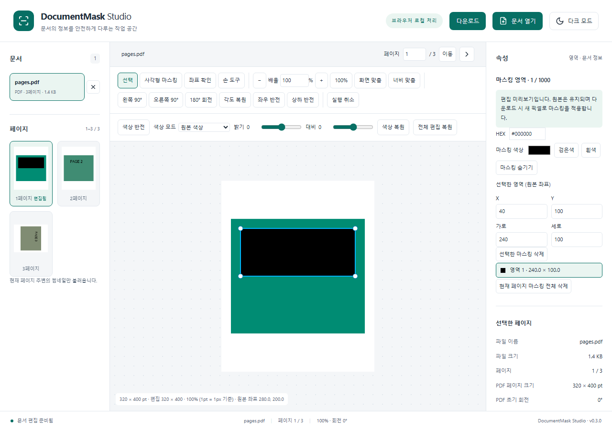
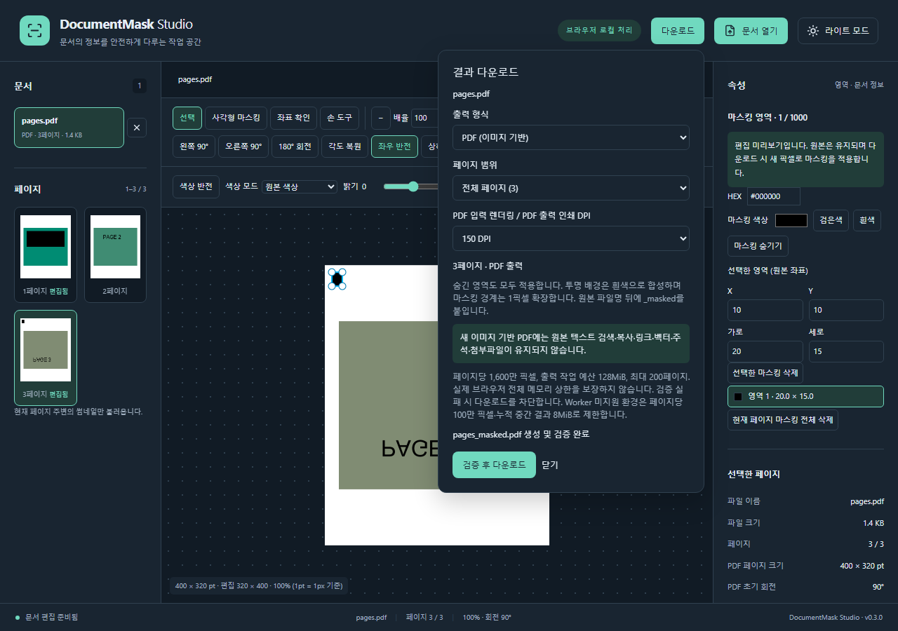

# DocumentMask Studio

React + TypeScript로 만든 브라우저 문서 편집·영구 마스킹 도구입니다. 이미지와 다중 페이지 PDF/TIFF를 열고 편집한 뒤, 지정 영역을 새 픽셀로 덮은 결과를 다운로드합니다. 선택한 파일을 외부 서버에 업로드하지 않습니다.

[웹 애플리케이션](https://heoseongbin.github.io/MaskingViewer/) · [소스 코드](https://github.com/HeoSeongbin/MaskingViewer) · [아키텍처](docs/ARCHITECTURE.md)

현재 릴리스는 **v0.3.0**입니다. Phase 1–7을 명시한 지원 범위에서 구현·검증했습니다. GitHub Actions의 실제 빌드/배포와 공개 HTTPS 사이트에서 Chromium·Edge의 이미지/PDF/TIFF 다운로드·재개방 검사를 통과했습니다. 검증한 커밋과 실행 증거는 [PROGRESS.md](docs/PROGRESS.md)에 기록합니다.



## 주요 기능과 사용 흐름

1. **문서 열기** 또는 Drag & Drop으로 여러 파일을 선택합니다.
2. 파일 목록과 썸네일에서 페이지를 이동합니다. 페이지 번호 직접 입력도 지원합니다.
3. 확대/이동/회전/반전/색상을 편집하고 사각형 마스킹을 생성합니다.
4. 영역을 이동·크기 조절하거나 X/Y/가로/세로·색상을 입력합니다. 목록, 선택 삭제, 전체 삭제, Undo/Redo를 지원합니다.
5. **다운로드**에서 현재/전체 범위와 형식을 고릅니다. 결과를 검증한 뒤 `_masked` 파일로 다운로드합니다.

숨김은 편집 미리보기만 바꾸며 출력에는 모든 마스킹을 적용합니다. 원본 파일을 공유하는 대신 생성한 결과 파일을 사용하세요. 원본 File과 편집 세션의 정보는 유지하며 새로고침/닫기 시 편집 상태가 초기화됩니다.

| 기능        | 지원                                                                   |
| ----------- | ---------------------------------------------------------------------- |
| 입력        | PNG, JPEG, BMP, GIF 첫 프레임, WEBP, PDF, TIFF                         |
| 다중 페이지 | PDF/TIFF, 페이지별 편집·마스킹·이력 보존                               |
| 보기        | 1–800%, 화면/너비 맞춤, 포인터 중심 zoom, Hand/휠 이동                 |
| 편집        | 90° 단위 회전, 화면 기준 양축 반전, 색상 반전·Grayscale·흑백·밝기·대비 |
| 마스킹      | 검은색·흰색·6자리 HEX의 불투명 사각형, 생성·이동·모서리 resize·삭제    |
| 출력        | PNG/JPEG, 새 이미지 기반 다중 PDF, 페이지 이미지 ZIP, 단일/다중 TIFF   |
| 사용성      | 한국어, light/dark, 반응형, 키보드 제어·자동 접근성 검사               |

### 키보드

Ctrl+휠은 포인터 중심 확대, Hand 드래그/휠/Shift+휠·뷰어 방향키는 이동입니다. Ctrl+Z / Ctrl+Shift+Z / Ctrl+Y는 현재 페이지 이력을 되돌립니다. Delete는 선택 마스킹을 삭제하며 Escape는 미완성 드래그를 취소합니다. 다운로드를 열면 첫 형식 선택에 포커스하고 Escape/닫기 후 버튼으로 돌아갑니다. 출력 중 Escape는 취소합니다.

## 실행과 검사

Node.js 24 / npm을 기준으로 검증했습니다.

```sh
npm ci
npm run dev
```

```sh
npm run typecheck
npm run lint
npm run format:check
npm test
npm run build
npm run preview
```

PDF.js worker·CMap·폰트·WASM·ICC 자원은 설치 패키지에서 `predev/prebuild`로 복사합니다. CDN과 문서 업로드 API를 사용하지 않습니다. `public/pdfjs`와 `build-info.json`은 생성물이며 Git에 포함하지 않습니다.

### Production 브라우저 검사

```powershell
$env:VITE_BASE_PATH = '/MaskingViewer/'
$env:PLAYWRIGHT_CHANNEL = 'chromium'
npm run build
npm run test:e2e
```

bundled Chromium은 `npx playwright install chromium`으로 준비합니다. Windows 기본은 설치된 Edge이며 `PLAYWRIGHT_CHANNEL=msedge`로 지정할 수 있습니다. 직접 생성한 fixture를 사용하므로 실제 개인정보 파일이 필요하지 않습니다. 실패 시 `test-results`의 screenshot/trace를 확인하세요.

## 기술 스택과 구조

### 언어와 실행 기반

선택 기준은 브라우저 로컬 파일 처리, 원본 좌표의 일관성, 출력 결과 검증, 정적 배포입니다. 아래 효과는 현재 코드에서 사용하는 방식에 대한 설명이며, 라이브러리 도입만으로 성능이나 출력 보안이 보장되는 것은 아닙니다.

| 언어·기술                        | 사용한 이유                                                                                                                | 이 프로젝트에서 얻은 장점과 효과                                                                                                                                                                                                         |
| -------------------------------- | -------------------------------------------------------------------------------------------------------------------------- | ---------------------------------------------------------------------------------------------------------------------------------------------------------------------------------------------------------------------------------------- |
| TypeScript 6 · TSX               | 문서 모델, 좌표, 편집 이력, 출력 형식과 Worker 메시지의 계약을 명시하기 위해 사용합니다.                                   | `strict`, `noUncheckedIndexedAccess`, `exactOptionalPropertyTypes`로 누락 값과 잘못된 상태 접근을 검사합니다. Adapter·UI·출력 모듈 사이의 변경 영향을 타입 검사에서 확인할 수 있습니다. 실제 파일 내용과 픽셀은 별도 실행 시 검증합니다. |
| JavaScript · ES Modules          | 브라우저 실행 코드와 Node.js의 `.mjs` 빌드·fixture 스크립트에 사용합니다. TypeScript 앱도 빌드 후 JavaScript로 실행됩니다. | PDF 자원 복사, 빌드 정보 생성, 테스트 문서 생성을 저장소 안의 스크립트로 재현합니다. 동적 import로 출력 시에만 필요한 인코더를 나누어 읽습니다.                                                                                          |
| HTML · CSS                       | 문서 작업 화면의 구조, 버튼·입력 접근성, 반응형 배치와 테마를 표현합니다.                                                  | Canvas 밖의 도구와 속성 패널을 일반 DOM으로 구성해 키보드·포커스 처리를 적용하고, CSS 변수로 light/dark 색상을 일관되게 관리합니다.                                                                                                      |
| React 19 · React DOM             | 파일 목록·뷰어·도구·속성·다운로드 화면을 상태에 따라 함께 갱신하기 위해 사용합니다.                                        | 컴포넌트와 Hook으로 UI 및 입력 연계를 분리하고, 같은 페이지 편집 상태를 여러 패널에 반영합니다. 문서 디코딩·좌표 계산·출력은 독립 모듈에서 재사용합니다.                                                                                 |
| Vite 8 · React/Tailwind 플러그인 | React 개발 환경, TypeScript 소스 변환, CSS 처리와 정적 산출물 생성을 한 설정에서 관리합니다.                               | ES module Worker와 동적 import를 빌드에 포함하고, `base` 설정으로 `/MaskingViewer/` 하위 경로에 배포합니다. 별도 애플리케이션 서버 없이 GitHub Pages에서 실행할 수 있습니다. 타입 검사는 별도 `tsc --noEmit`으로 수행합니다.             |

### 화면·상태 관리와 문서 처리 라이브러리

| 라이브러리            | 사용한 이유                                                                           | 이 프로젝트에서 얻은 장점과 효과                                                                                                                                                                 |
| --------------------- | ------------------------------------------------------------------------------------- | ------------------------------------------------------------------------------------------------------------------------------------------------------------------------------------------------ |
| Tailwind CSS 4        | 유틸리티 스타일을 공통 CSS 클래스·디자인 토큰과 함께 사용하기 위해 도입했습니다.      | 반복되는 배치 스타일을 조합하고 CSS 변수 기반 색상·간격을 공유해 패널과 테마의 시각적 일관성을 유지합니다.                                                                                       |
| Lucide React          | 도구 모음과 파일·페이지 이동에 같은 형태의 아이콘이 필요합니다.                       | React 컴포넌트로 아이콘 크기·색상을 맞추고 버튼의 텍스트·접근성 이름과 함께 기능을 표시합니다.                                                                                                   |
| Zustand 5             | 문서 선택, 페이지별 마스킹·이미지 편집·Undo/Redo를 여러 UI에서 공유합니다.            | 컴포넌트 사이의 반복적인 props 전달을 줄이고 페이지 전환 후에도 편집·이력을 보존합니다. File·Canvas·Worker는 별도 관리하여 이력마다 원본 바이너리를 복제하지 않습니다.                           |
| Konva · react-konva   | Canvas 위 문서 이미지와 사각형 영역의 표시·선택·드래그·크기 변경이 필요합니다.        | Stage/도형을 React 상태와 연결해 편집 화면을 구성합니다. 공통 affine 변환 모듈과 결합해 확대·회전·반전 중에도 원본 마스킹 좌표를 유지합니다. 영구 마스킹 출력은 별도의 픽셀 처리에서 수행합니다. |
| PDF.js · pdfjs-dist 6 | 일반 이미지 디코더가 처리하지 못하는 PDF의 페이지·크기·초기 회전을 읽고 렌더링합니다. | 필요한 페이지를 Canvas로 렌더링해 공통 문서 모델로 편집합니다. 전용 Worker와 CMap·폰트·WASM 자원을 같은 사이트에서 제공하여 외부 문서 변환 서비스 없이 입력을 처리합니다.                        |
| UTIF.js               | TIFF의 IFD 페이지 정보와 지원 압축 방식의 픽셀을 디코딩합니다.                        | 다중 TIFF를 페이지 단위로 편집하고, 자체 TIFF 인코더로 만든 결과를 다시 디코딩해 페이지 수·전체 픽셀을 비교합니다. TIFF 출력 인코더 자체는 프로젝트에서 구현했습니다.                            |
| pako                  | TIFF Deflate 디코딩 의존성과 PDF 출력 이미지의 Flate 압축 해제가 필요합니다.          | TIFF Worker에 `self.pako`를 명시적으로 제공하고, 출력 PDF의 RGB 스트림을 풀어 기대 픽셀의 SHA-256과 비교합니다. 파일 생성 성공 여부 외에 실제 이미지 내용도 검사할 수 있습니다.                  |
| pdf-lib               | 마스킹이 끝난 이미지만 담은 새로운 다중 페이지 PDF를 브라우저에서 생성합니다.         | 원본 PDF 페이지를 복사하지 않는 출력 구조를 구현하고, 생성 파일을 다시 읽어 이미지 구조·페이지 수·불필요한 객체 부재를 검사합니다. 검색 텍스트·벡터·링크는 유지되지 않습니다.                    |
| JSZip                 | 여러 페이지의 PNG/JPEG를 하나의 다운로드 파일로 묶습니다.                             | 페이지 순서와 파일명을 유지한 ZIP을 만들고 재개방하여 CRC·항목·바이트를 검사합니다. 이미 인코딩된 이미지는 `STORE` 방식으로 담아 ZIP 단계에서 다시 압축하지 않습니다.                            |

Web Workers, OffscreenCanvas, Canvas, File/Blob, AbortController, Web Crypto는 추가 라이브러리가 아닌 **브라우저 API**입니다. Worker로 TIFF 디코딩·색상 처리·출력 합성 및 최종 조립을 나누고, transferable buffer로 데이터 복사를 줄이며 취소 시 작업을 종료합니다. 지원 환경에서는 OffscreenCanvas로 Worker 안에서 이미지를 인코딩합니다. SHA-256은 PDF 출력 이미지 검증에 사용합니다. 이 구성이 모든 처리 구간의 비동기 실행이나 무제한 메모리를 보장하지는 않으며, 미지원 환경과 작업 예산은 아래 지원 한도를 따릅니다.

### 테스트·코드 품질과 배포 도구

| 도구                                                      | 사용한 이유                                                                                     | 이 프로젝트에서 얻은 장점과 효과                                                                                                                                                             |
| --------------------------------------------------------- | ----------------------------------------------------------------------------------------------- | -------------------------------------------------------------------------------------------------------------------------------------------------------------------------------------------- |
| Vitest                                                    | 좌표·마스킹·상태·출력 커널을 UI 조작과 분리해 반복 검증합니다.                                  | 회전/반전 조합, 경계 처리, 픽셀 합성, 이력과 리소스 정리의 회귀를 검사합니다. Vite 설정과 TypeScript 소스를 함께 사용합니다.                                                                 |
| Testing Library · user-event · jest-dom · jsdom           | DOM 환경에서 사용자 입력과 화면 상태를 검사합니다.                                              | 버튼·입력·접근성 이름을 기준으로 컴포넌트 동작을 검증하고 DOM용 assertion을 사용합니다. 실제 Canvas·Worker·다운로드 검사는 Playwright로 보완합니다.                                          |
| Playwright · @napi-rs/canvas                              | 실제 브라우저에서 파일을 열고 편집·다운로드하는 흐름과 재현 가능한 이미지 fixture가 필요합니다. | Node.js에서 생성한 fixture로 Chromium·Edge의 복합 편집, 결과 파일 픽셀·페이지, 재열기와 배포 경로를 검사합니다. Canvas 패키지는 테스트용이며 앱의 브라우저 런타임 의존성이 아닙니다.         |
| axe-core · @axe-core/playwright                           | 화면 상태별 접근성 문제를 자동 탐지합니다.                                                      | light/dark·모바일·다운로드 화면의 대비와 접근성 규칙을 검사합니다. 실제로 발견한 색상 대비 문제를 수정했으며, 모든 스크린리더 조합의 검증을 대체하지는 않습니다.                             |
| ESLint · typescript-eslint · React Hooks/Refresh 플러그인 | TypeScript·React 코드의 오류 가능성과 Hook 사용 규칙을 검사합니다.                              | 미사용 코드와 Hook 규칙 위반 등을 CI에서 차단하고, 일관된 개발 규칙을 유지합니다.                                                                                                            |
| Prettier                                                  | 코드·설정·문서의 서식을 자동으로 통일합니다.                                                    | 서식 수정 작업과 불필요한 diff를 줄이고 `format:check`로 동일한 기준을 적용합니다.                                                                                                           |
| Node.js · npm · GitHub Actions/Pages                      | 설치·검증·정적 배포 과정을 재현합니다.                                                          | 잠금 파일 기반 `npm ci`와 자동 검사를 통과한 산출물을 Pages에 배포합니다. 서버 운영 없이 공개할 수 있으며, Node.js는 개발·빌드·테스트에 사용하고 사용자 문서 처리는 브라우저에서 수행합니다. |

### 폴더 구조

```text
src/
  app/                 애플리케이션·디자인 토큰
  components/          레이아웃·뷰어·도구·속성·다운로드 UI
  features/file-upload 파일 작업과 문서 수명주기
  adapters/            raster/PDF/TIFF 정규화
  core/document/       Loader·공통 모델·페이지 렌더 큐·LRU
  core/geometry/       affine 정방향·역방향 변환
  core/masking/        원본 좌표 영역 관리
  core/image/          공통 색상 커널
  core/export/         새 픽셀·Worker 조정·인코딩·검증
  stores/ hooks/       직렬화 상태와 React/입력 연계
  workers/ tests/      비동기 처리와 단위 검사
e2e/ scripts/ docs/   재현 fixture·실제 브라우저 검사·설계/진행 기록
```

원본 File/Canvas/Worker를 이력마다 복제하지 않습니다. `documentId:pageIndex`로 편집과 이력을 관리하고 loader/adapter/renderer가 포맷 차이와 바이너리 수명주기를 소유합니다. 자세한 데이터 흐름과 Mermaid 도식은 [ARCHITECTURE.md](docs/ARCHITECTURE.md)에 있습니다.

## 좌표와 영구 마스킹

마스킹은 화면이 아니라 정규화된 원본 페이지 좌표입니다. `원본 → 회전 → 화면 기준 반전 → 양수 경계 보정 → zoom/pan → Stage` 행렬과 역행렬을 같은 모듈에서 사용합니다. 일반 이미지/TIFF는 원본 px, PDF는 초기 viewport 회전을 적용한 pt 좌표입니다. HiDPI와 최대 1,800px 미리보기는 이 기준과 별개입니다.

출력은 원본 해상도 또는 PDF 150/300 DPI의 새 RGBA에 색상·흰색 배경·불투명 마스킹을 적용하고, 보간 없는 정수 회전/반전으로 변환합니다. 영역 경계는 바깥 방향 반올림과 사방 1 출력 픽셀 여백을 적용합니다. 투명 배경과 숨은 RGB는 흰색으로 합성됩니다. zoom/pan/숨김/DPR은 출력에 들어가지 않습니다.

PDF는 새 문서에 처리된 이미지밖에 넣지 않습니다. 원본 PDF 객체·검색 텍스트·주석·첨부·숨김 layer·원본 metadata를 재사용하지 않습니다. 결과에서 텍스트 검색/복사/링크/벡터 기능은 유지되지 않습니다. Stage 스크린샷이나 원본 PDF에 Rectangle 주석을 추가한 파일을 결과로 사용하지 않습니다.

| 출력 | 실제 검증과 제한                                                                                           |
| ---- | ---------------------------------------------------------------------------------------------------------- |
| PNG  | 재디코딩 크기와 전체 RGBA 정확 비교                                                                        |
| JPEG | 이미 제거된 픽셀을 품질 0.98로 압축; 불투명·크기·마스킹 채널 오차 ≤64 검사. 정확한 단색은 무손실 형식 사용 |
| PDF  | 새 RGB8 이미지 구조·크기, 원본 객체 부재, 추출 전체 RGB SHA-256 비교                                       |
| TIFF | classic little-endian RGB8 무압축, 페이지별 strip·IFD 체인. UTIF로 전체 페이지·픽셀 비교                   |
| ZIP  | 새 PNG/JPEG만 순서대로 STORE 압축, CRC/항목/바이트 재검증                                                  |

검사 실패/취소 시 다운로드하지 않습니다. 지정 mask의 새 결과물에 관한 검증이며 원본 파일 삭제나 모든 복구 공격에 대한 보안 인증은 아닙니다. 원본과 같은 형식은 지원되는 PNG/JPEG/PDF/TIFF에 제공하고 BMP/GIF/WEBP는 PNG가 기본입니다.



## 지원 한도와 남은 범위

- 입력: 파일당 100MiB, 열린 파일 총 200MiB, 50문서/문서당 5,000페이지. raster/TIFF는 페이지당 1,600만 픽셀·한 변 16,384 한도입니다.
- 편집: 페이지당 1,000 mask, 최소 가로/세로 원본 기준 1, 페이지별 이력 최대 100개입니다.
- 출력: 최대 200페이지, 128MiB 추정 작업 예산. 한도 아래 입력도 출력 중간 버퍼 예산 때문에 거부할 수 있습니다. 자동 화질 저하 대신 낮은 PDF DPI/페이지 범위 변경을 안내합니다.
- Worker 미지원 fallback: 페이지당 100만 픽셀, 중간 결과 총 8MiB. TIFF 입력은 Worker가 필요합니다.
- GIF 다중 프레임과 암호 PDF 입력은 미지원(해제 안내 제공). TIFF는 classic strip/1·8bit 일부 구성을 지원하며 BigTIFF/tile/16bit/planar-separated/JPEG-in-TIFF는 거부합니다.
- SVG/HEIC/AVIF/ICO는 미지원. TIFF 출력 압축/EXIF/DPI metadata 보존과 파일 시스템 스트리밍은 제공하지 않습니다.
- Firefox/Safari·실제 터치·스크린리더, native/Canvas/GPU 전체 메모리와 다양한 대용량 코퍼스는 아직 미검증입니다.

## 성능과 검증 결과

픽셀 Worker는 4.31KB이며 무거운 최종 인코더는 필요할 때 읽습니다. PDF는 원시 RGBA 대신 PNG+RGB 해시만 누적합니다. decode/페이지 처리는 순차이며 주변 7개 thumbnail/48MiB LRU, Canvas 0 크기 해제, bitmap.close, Worker terminate, Blob URL revoke를 적용합니다. 취소/오류/60초 timeout과 단일 출력 lock을 검사합니다.

단위 테스트 **164개**, production 서브경로 Chromium/Edge **각 34개**가 통과했습니다. Linux GitHub Actions의 전체 검증·배포도 성공했고 공개 Pages에서 별도 릴리스 검사 **각 3개**가 통과했습니다. 실제 배포 증거는 [PROGRESS.md](docs/PROGRESS.md)를 기준으로 합니다. 이전 검증에서 axe WCAG A/AA 태그의 빈 화면/편집/light/dark/mobile 위반 0을 확인했으며 모든 스크린리더의 접근성 인증은 아닙니다.

[Chromium](docs/performance/phase-6-chromium.json) / [Edge](docs/performance/phase-6-msedge.json) 표본은 120페이지 PDF/TIFF 전체 출력과 400만 픽셀 PNG, 8회 반복 닫기의 JS heap을 기록합니다. 강제 GC 후 heap 증가 32MiB 이하를 검사합니다. native/Canvas/GPU/전체 Worker 메모리와 전체 순간 peak를 포함하지 않는 표본이며 보편 성능 보장은 아닙니다. [실제 Linux CI 표본](docs/performance/phase-7-linux-ci.json)도 artifact에서 내려받아 보관했습니다.

## GitHub Pages와 공개 사이트 검증

공개 주소는 https://heoseongbin.github.io/MaskingViewer/ 입니다. Pages 게시 소스를 **GitHub Actions**로 사용하며 build→type/lint/format/unit→Chromium 전체 E2E를 통과한 dist만 배포합니다. 저장소 이름으로 base를 계산하고 PDF.js 리소스·module Worker·lazy 인코더가 같은 사이트에서 로드됩니다. custom domain은 base 정책을 별도로 변경해야 합니다.

`build-info.json`에는 version/commit/base/builtAt 및 로컬 dirty 표시가 생성됩니다. CI는 GITHUB_SHA를 기록합니다. 로컬 dirty 빌드는 commit이 같아도 미커밋 코드가 포함될 수 있으며 공개 릴리스 검증은 정확한 SHA와 dirty=false를 요구합니다. 이 파일의 존재만으로 실제 기능을 검증하지 않습니다.

```powershell
$env:DEPLOYMENT_URL = 'https://heoseongbin.github.io/MaskingViewer/'
$env:EXPECTED_REVISION = '<확인할 전체 커밋 SHA>'
$env:PLAYWRIGHT_CHANNEL = 'chromium'
npm run test:deployment
```

배포 검사는 서버를 새로 시작하지 않고 실제 HTTPS 사이트에서 이미지/PDF/TIFF를 업로드하고, 마스킹·회전·반전·다운로드·픽셀/페이지 검증과 결과 재개방을 실행합니다. 로컬 검증/원격 CI/공개 사이트 검증은 구분합니다. CI 실패 진단과 새 성능 보고서는 artifact로 7일 보관합니다.

화면은 실제 fixture 검사에서 재현합니다.

```powershell
$env:CAPTURE_PHASE7 = '1'
npm run test:e2e -- e2e/release.spec.ts
Remove-Item Env:CAPTURE_PHASE7
```

## 프로젝트 문서

[PROJECT.md](PROJECT.md): 요구사항 기준 · [AGENTS.md](AGENTS.md): 작업 규칙 · [PROGRESS.md](docs/PROGRESS.md): 단계/검증/배포 증거 · [DECISIONS.md](docs/DECISIONS.md): 기술 결정 · [ARCHITECTURE.md](docs/ARCHITECTURE.md): 좌표/출력/리소스 구조
