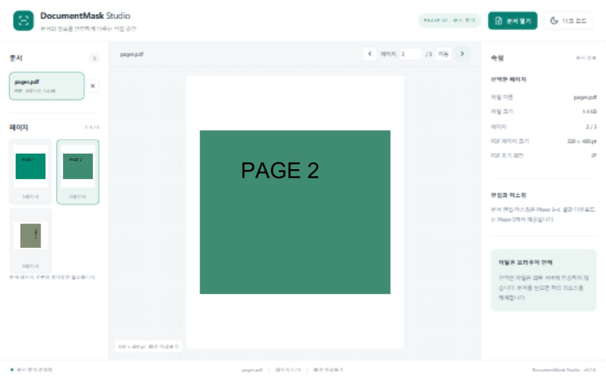

# DocumentMask Studio

React + TypeScript 기반 브라우저 문서 편집 및 영구 마스킹 프로젝트입니다. 원본 파일을 서버에 업로드하지 않는 구조를 목표로 합니다.

현재 **Phase 2 문서 업로드 및 탐색**까지 구현했습니다. 파일 선택·Drag & Drop·여러 파일 로딩, PNG/JPEG/BMP/GIF/WEBP 및 다중 페이지 PDF/TIFF 미리보기, 파일 목록·썸네일·페이지 번호 이동과 테마 전환을 제공합니다. 편집, 영구 마스킹 및 다운로드는 아직 제공하지 않습니다.

PDF.js, UTIF Worker, Konva/react-konva를 공통 문서 어댑터 구조로 연결했습니다. 원본 크기와 화면 미리보기를 분리하고 필요한 페이지만 렌더링합니다. 파일을 닫거나 업로드를 취소할 수 있으며 오류가 난 파일이 있어도 나머지 파일을 계속 엽니다.

## 실행

Node.js 24와 npm을 권장합니다.

```sh
npm ci
npm run dev
```

```sh
npm run typecheck
npm run lint
npm run format:check
npm test
npm run build
npm run preview
```

PDF.js의 폰트/CMap/WASM/ICC 자원은 predev/prebuild에서 설치된 패키지로부터 자동 복사합니다. worker와 모든 문서 리소스는 로컬 사이트에 포함하며 CDN을 사용하지 않습니다.

## 지원 범위 및 제한

- 파일당 100MiB, 열린 파일 총 200MiB, 최대 50문서/문서당 5,000페이지입니다. 이미지/TIFF는 페이지당 1,600만 픽셀과 한 변 16,384 제한을 검사합니다.
- GIF는 첫 프레임만 표시합니다. PDF 암호 입력은 제공하지 않고 보호된 파일에 해제 안내를 표시합니다.
- TIFF는 classic strip 기반 무압축, CCITT G3/G4, LZW, Deflate, PackBits를 지원합니다. BigTIFF, tile, 16bit, planar-separated 및 JPEG-in-TIFF 등은 아직 지원하지 않습니다. 테스트한 fixture 범위 밖의 변형은 실패할 수 있습니다.
- SVG/HEIC/AVIF/ICO는 미지원입니다. JPEG 크기 헤더는 첫 1MiB까지 검사하며 확인할 수 없는 파일은 거부합니다.
- 썸네일은 현재 페이지 주변 최대 7개, 160px로 표시합니다. 화면 미리보기는 최대 1,800px이며 원본 출력 해상도를 뜻하지 않습니다.
- 테마와 열린 파일은 새로고침 후 초기화됩니다. 테스트 브라우저는 Windows Edge이며 다른 브라우저와 대용량 코퍼스 검증은 남아 있습니다.

## 브라우저 자동 테스트

Windows에서는 설치된 Microsoft Edge를 사용합니다. Linux/macOS에서는 `npx playwright install chromium`으로 테스트 브라우저를 준비하세요. fixture는 코드로 생성하므로 민감한 실제 문서가 필요하지 않습니다.

```powershell
$env:VITE_BASE_PATH = '/MaskingViewer/'
npm run build
npm run test:e2e
Remove-Item Env:VITE_BASE_PATH
```

단위 테스트 23개와 production 서브경로 E2E 10개를 검증했습니다. 입력 포맷, 다중 페이지 픽셀/방향, 파일 전환/닫기, 페이지 번호/썸네일 탐색, 오류/암호 안내, DnD 및 모바일 화면을 검사합니다. 이 결과는 편집이나 영구 마스킹 보안 검증을 의미하지 않습니다.



## 구조

`src/app`: 애플리케이션과 디자인 토큰, `components`: UI, `stores`: Zustand 상태, `features`: 사용자 작업, `core`: 문서/좌표/마스킹/출력 로직, `adapters`: 형식별 처리, `workers`: 비동기 처리, `tests`: 자동화 검증. 이후 단계용 디렉터리는 의도적으로 구현이 없는 경계입니다.

공통 페이지 모델로 포맷별 어댑터를 연결하고, 원본 페이지 좌표에서 편집 상태를 보존합니다. 출력은 처리된 새 픽셀만 인코딩하도록 설계합니다. PDF 출력은 이미지 기반 재생성이므로 검색/복사/링크/벡터 정보가 유지되지 않을 예정입니다. 아직 마스킹 보안 검증 결과는 없습니다.

전체 요구사항은 [PROJECT.md](PROJECT.md), 작업 상태는 [docs/PROGRESS.md](docs/PROGRESS.md), 아키텍처와 제약은 [docs/DECISIONS.md](docs/DECISIONS.md)를 확인하세요.

## GitHub Pages

`.github/workflows/pages.yml`에서 PR 검증과 main 배포를 구성했습니다. 빌드 후 Chromium 브라우저 테스트도 통과해야 배포됩니다. 원격 저장소는 연결했습니다. Settings → Pages → Source를 GitHub Actions로 설정해야 하며 실제 Pages 배포는 아직 검증하지 않았습니다.

Vite는 로컬에서 `/`, CI에서는 저장소 이름으로 계산한 base를 사용합니다. 직접 서브경로 빌드 시 PowerShell에서 다음과 같이 실행합니다.

```powershell
$env:VITE_BASE_PATH = '/MaskingViewer/'
npm run build
Remove-Item Env:VITE_BASE_PATH
```

Phase 2에서 해당 production 서브경로로 실제 PDF/TIFF/이미지 및 worker 로딩을 검증했습니다. 실제 GitHub Pages 호스팅 검증은 남아 있습니다.
