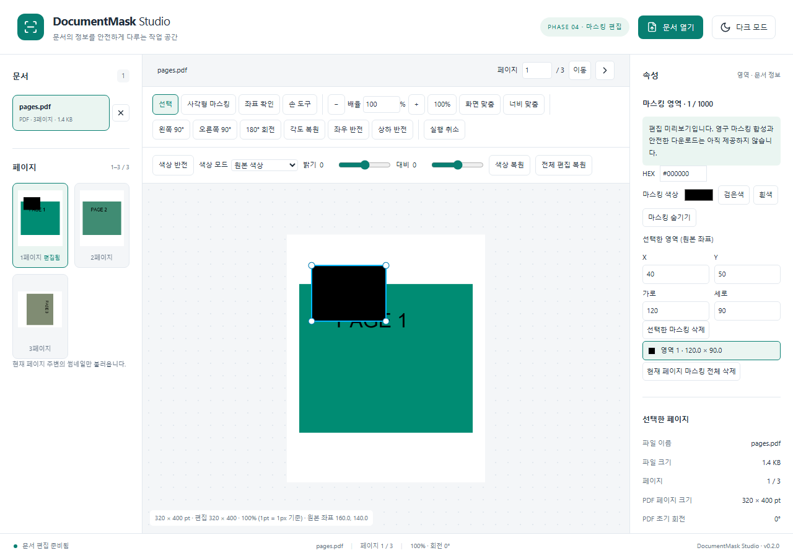

# DocumentMask Studio

React + TypeScript 기반 브라우저 문서 편집 및 영구 마스킹 프로젝트입니다. 원본 파일을 서버에 업로드하지 않는 구조를 목표로 합니다.

현재 **Phase 4 마스킹 편집**까지 구현했습니다. 파일 선택·Drag & Drop, 이미지와 다중 페이지 PDF/TIFF 탐색, 확대·이동·회전·반전·색상 처리에 더해 사각형 마스킹 생성/선택/이동/크기 조절/삭제와 페이지별 Undo/Redo를 제공합니다. 영구 픽셀 마스킹 합성과 다운로드는 아직 제공하지 않습니다.

PDF.js, UTIF Worker, Konva/react-konva를 공통 문서 어댑터 구조로 연결했습니다. 원본 크기와 화면 미리보기를 분리하고 필요한 페이지만 렌더링합니다. 파일을 닫거나 업로드를 취소할 수 있으며 오류가 난 파일이 있어도 나머지 파일을 계속 엽니다.

## 실행

Node.js 24와 npm을 권장합니다.

```sh
npm ci
npm run dev
```

```sh
npm run typecheck
npm run lint
npm run format:check
npm test
npm run build
npm run preview
```

PDF.js의 폰트/CMap/WASM/ICC 자원은 predev/prebuild에서 설치된 패키지로부터 자동 복사합니다. worker와 모든 문서 리소스는 로컬 사이트에 포함하며 CDN을 사용하지 않습니다.

## 지원 범위 및 제한

- 파일당 100MiB, 열린 파일 총 200MiB, 최대 50문서/문서당 5,000페이지입니다. 이미지/TIFF는 페이지당 1,600만 픽셀과 한 변 16,384 제한을 검사합니다.
- GIF는 첫 프레임만 표시합니다. PDF 암호 입력은 제공하지 않고 보호된 파일에 해제 안내를 표시합니다.
- TIFF는 classic strip 기반 무압축, CCITT G3/G4, LZW, Deflate, PackBits를 지원합니다. BigTIFF, tile, 16bit, planar-separated 및 JPEG-in-TIFF 등은 아직 지원하지 않습니다. 테스트한 fixture 범위 밖의 변형은 실패할 수 있습니다.
- SVG/HEIC/AVIF/ICO는 미지원입니다. JPEG 크기 헤더는 첫 1MiB까지 검사하며 확인할 수 없는 파일은 거부합니다.
- 썸네일은 현재 페이지 주변 최대 7개, 160px로 표시합니다. 화면 미리보기는 최대 1,800px이며 원본 출력 해상도를 뜻하지 않습니다.
- 테마와 열린 파일은 새로고침 후 초기화됩니다. 테스트 브라우저는 Windows Edge 및 Playwright Chromium이며 다른 브라우저와 대용량 코퍼스 검증은 남아 있습니다.

## 브라우저 자동 테스트

Windows에서는 설치된 Microsoft Edge를 사용합니다. Linux/macOS에서는 `npx playwright install chromium`으로 테스트 브라우저를 준비하세요. fixture는 코드로 생성하므로 민감한 실제 문서가 필요하지 않습니다.

```powershell
$env:VITE_BASE_PATH = '/MaskingViewer/'
npm run build
npm run test:e2e
Remove-Item Env:VITE_BASE_PATH
```

단위 테스트 129개와 Windows Chromium/Edge 각각 production 서브경로 E2E 20개를 검증했습니다. 기존 입력/탐색/편집/Worker 회귀에 더해 HiDPI 2배 마스킹 생성/이동/resize, gesture 단위 Undo, 삭제/색상/숨김, 원본 좌표·경계·취소, PDF 초기 회전 및 PDF/TIFF 페이지별 상태, 모바일을 검사합니다. 영구 마스킹 보안은 아직 미검증입니다.



## 구조

`src/app`: 애플리케이션과 디자인 토큰, `components`: UI, `stores`: Zustand 상태, `features`: 사용자 작업, `core`: 문서/좌표/마스킹/출력 로직, `adapters`: 형식별 처리, `workers`: 비동기 처리, `tests`: 자동화 검증. 이후 단계용 디렉터리는 의도적으로 구현이 없는 경계입니다.

공통 페이지 모델로 포맷별 어댑터를 연결하고, 원본 페이지 좌표에서 편집 상태를 보존합니다. 출력은 처리된 새 픽셀만 인코딩하도록 설계합니다. PDF 출력은 이미지 기반 재생성이므로 검색/복사/링크/벡터 정보가 유지되지 않을 예정입니다. 아직 마스킹 보안 검증 결과는 없습니다.

전체 요구사항은 [PROJECT.md](PROJECT.md), 작업 상태는 [docs/PROGRESS.md](docs/PROGRESS.md), 아키텍처와 제약은 [docs/DECISIONS.md](docs/DECISIONS.md)를 확인하세요.

## GitHub Pages

`.github/workflows/pages.yml`에서 PR 검증과 main 배포를 구성했습니다. 빌드 후 Chromium 브라우저 테스트도 통과해야 배포됩니다. 원격 저장소는 연결했습니다. Settings → Pages → Source를 GitHub Actions로 설정해야 하며 실제 Pages 배포는 아직 검증하지 않았습니다.

Vite는 로컬에서 `/`, CI에서는 저장소 이름으로 계산한 base를 사용합니다. 직접 서브경로 빌드 시 PowerShell에서 다음과 같이 실행합니다.

```powershell
$env:VITE_BASE_PATH = '/MaskingViewer/'
npm run build
Remove-Item Env:VITE_BASE_PATH
```

Phase 2에서 해당 production 서브경로로 실제 PDF/TIFF/이미지 및 worker 로딩을 검증했습니다. 실제 GitHub Pages 호스팅 검증은 남아 있습니다.

## 문서 편집과 좌표

도구 모음에서 1–800% 배율을 입력한 뒤 Enter를 누르거나 화면/너비 맞춤을 선택하세요. Ctrl+휠은 포인터를 중심으로 확대하며 손 도구 드래그, 일반 휠, Shift+휠 및 뷰어에 포커스한 방향키로 이동합니다. 화면에서 보이는 방향으로 좌우/상하를 반전합니다.

색상 반전, Grayscale, 흑백(임계값 128), 밝기/대비를 독립적으로 적용할 수 있습니다. 색상 및 전체 편집 복원이 가능합니다. Ctrl+Z / Ctrl+Shift+Z / Ctrl+Y는 현재 페이지의 편집 이력을 되돌립니다. 문서/페이지 전환 시 편집은 유지되지만 새로고침 또는 문서 닫기 시 삭제됩니다.

좌표 확인 도구는 포인터의 정규화된 원본 좌표를 표시합니다. 원본 → 회전 → 화면 기준 반전 → 양수 경계 보정 → zoom/pan의 affine 행렬과 역행렬을 사용합니다. 일반 이미지/TIFF의 100%는 원본 픽셀당 CSS 1px이며 PDF는 초기 회전이 반영된 pt당 CSS 1px입니다. HiDPI backing buffer와 최대 1,800px 미리보기 해상도는 이 좌표와 별개입니다. PDF 출력 DPI와 실제 저장은 Phase 5에서 구현합니다.

색상 처리는 취소 가능한 로컬 Worker에서 새 픽셀 사본에 적용하며 thumbnail도 같은 색상/기하 커널을 사용합니다. 처리 오류 시 색상 복원으로 재개할 수 있습니다. 확대해도 미리보기의 디코딩 해상도가 자동으로 높아지지는 않습니다.

CI와 같은 bundled Chromium으로 Windows에서 브라우저 테스트를 실행할 수도 있습니다.

```powershell
npx playwright install chromium
$env:PLAYWRIGHT_CHANNEL = 'chromium'
npm run test:e2e
```

기본 Windows 실행기는 Edge이며 PLAYWRIGHT_CHANNEL=msedge로 명시할 수도 있습니다. Canvas 픽셀 검사는 Konva의 다음 프레임 그리기를 기다린 후 정확한 색상 값을 검사합니다. CI 실패 시 test-results artifact에서 스크린샷·오류 문맥·trace를 확인할 수 있습니다(7일 보관).

## 마스킹 편집

사각형 마스킹 도구로 문서 안에서 드래그하면 원본 좌표의 영역이 생성되고 선택 도구와 핸들이 활성화됩니다. 선택 도구에서 영역을 이동하거나 모서리로 크기를 바꿀 수 있습니다. 음수 방향 드래그와 모서리 교차를 정규화하고 페이지 경계를 제한합니다. 우측 목록과 X/Y/가로/세로 입력으로도 선택/수정할 수 있습니다.

검은색, 흰색, 색상 선택기 또는 6자리 HEX의 불투명 색상을 사용합니다. Delete 또는 선택 삭제, 현재 페이지 전체 삭제가 가능하며 Ctrl+Z/Ctrl+Shift+Z/Ctrl+Y로 회전·색상·마스킹의 동일한 편집 순서를 되돌립니다. 드래그는 놓는 순간 한 작업으로 기록하고 Escape/pointer 취소는 폐기합니다.

마스킹 숨김은 원본 preview 확인용입니다. 숨김 중 Canvas 편집은 차단하고 영역 데이터는 유지합니다. 전체 이미지 편집 복원도 masks를 보존합니다. 문서/페이지 전환 시 영역은 유지되며 닫기/새로고침 시 초기화됩니다. 페이지당 영역 1,000개, 가로/세로 최소 원본 기준 1단위, 이력 100개입니다. 작은 영역은 확대 또는 좌표 입력으로 수정하세요.

현재 Canvas와 썸네일의 영역은 편집 미리보기입니다. 원본 파일의 정보는 유지하며 안전한 다운로드 파일을 생성하지 않습니다. Phase 5에서 새 픽셀 합성, PDF 출력 DPI, 새 인코딩 및 원본 정보 잔존 검증을 구현해야 합니다.

문서용 화면은 기존 PDF/TIFF E2E에서 실제 gesture로 재현할 수 있습니다(서브경로 build 후 실행).

```powershell
$env:PLAYWRIGHT_CHANNEL = 'chromium'
$env:CAPTURE_PHASE4 = '1'
npm run test:e2e -- e2e/masking.spec.ts --grep 'PDF and TIFF'
Remove-Item Env:CAPTURE_PHASE4
```
