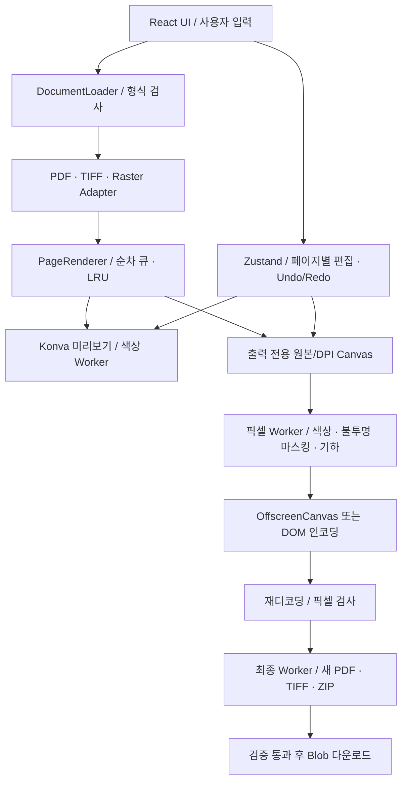

# DocumentMask Studio 아키텍처

구현 기준은 PROJECT.md, 결정 이력은 DECISIONS.md다. v0.3.0은 백엔드 없이 브라우저에서 로컬 문서를 처리한다. 원본 File과 화면 미리보기, 새 출력 픽셀은 별도 수명주기를 갖는다.

## 책임과 데이터 흐름



| 계층      | 주요 파일                               | 책임                                                |
| --------- | --------------------------------------- | --------------------------------------------------- |
| UI        | src/components, src/app                 | 입력·상태·오류 표시, 레이아웃·테마                  |
| 작업 조정 | features/file-upload/documentActions.ts | 순차 업로드, 문서 수명주기·취소                     |
| 문서 코어 | core/document                           | 형식/크기 검사, Adapter 계약, 페이지 렌더 큐·캐시   |
| Adapter   | adapters/pdf, tiff, raster              | 포맷별 decode, 초기 방향 정규화                     |
| 편집      | stores/editStore.ts                     | documentId:pageIndex 상태/이력, UI 선택·숨김        |
| Geometry  | core/geometry                           | 순수 affine 행렬, 정방향·역방향 좌표                |
| Mask      | core/masking, hooks/useMaskGesture.ts   | 원본 좌표 영역, hit/move/resize, 한 gesture 한 이력 |
| Output    | core/export                             | 출력 해상도, 새 픽셀, 인코딩·검증, 동시 출력 제한   |
| Worker    | workers                                 | PDF.js/TIFF decode, 색상, 출력 합성/최종 조립       |

문서 바이너리/Canvas/Worker는 Zustand 이력에 넣지 않는다. Undo/Redo는 페이지별 serializable 편집 상태만 최대 100개 보관한다. 확대/pan/선택/숨김은 편집 이력과 구분한다. 파일 전환은 페이지/편집을 유지하고 문서 닫기는 adapter·편집·이력·캐시 참조를 해제한다.

## 좌표계와 변환

일반 이미지/TIFF는 EXIF 또는 TIFF orientation을 정규화한 원본 px를 기준으로 한다. PDF는 PDF.js 초기 viewport 회전이 이미 반영된 1px/pt 페이지 좌표다. 미리보기의 최대 1,800px와 Stage backing DPR을 이 기준 좌표에 누적하지 않는다.

```text
source → R(0/90/180/270) → F(화면 기준 좌우/상하) → 양수 경계 보정
       → zoom → Stage 중심 배치 + pan → CSS screen

입력: CSS screen → DOM rect 비율로 Stage → 전체 affine 역행렬 → source
```

행렬은 Canvas 규약 `[a,b,c,d,e,f]`이며 `x'=ax+cy+e`, `y'=bx+dy+f`다. 화면 행렬은 `placement × zoom × boundsTranslation × flip × rotation` 순으로 합성한다. 저장된 mask의 x/y/width/height에는 zoom/pan/DPR이 들어가지 않는다. 가로·세로는 홀수 90°에서 교환한다. 음수 드래그·모서리 교차는 정규화하고 경계에 clamp한다.

예: 원본 100×60에서 사각형 `(10,10,20,15)`를 시계 방향 90° 회전한 뒤 화면 기준 좌우 반전하면 픽셀 중심은 `(x,y)→(y,x)`다. 결과 크기는 60×100이고 `(15,15)`의 가려진 내용은 출력에서도 검은 픽셀이다. 같은 변환을 preview·thumbnail·output이 사용한다. PDF 출력은 150/300 DPI의 실제 raster 가로/세로 비율로 pt mask를 변환하고 PDF 물리 pt 크기는 유지한다.

## 영구 마스킹

원본 해상도/DPI decode → 새 RGBA 사본 → 동일 색상 커널 → 흰색 배경 불투명 합성 → 원본 raster의 마스킹 → 보간 없는 정수 회전/반전 → 새 인코더 → 재디코딩/구조 검증 순이다. 영역은 floor/ceil로 바깥 방향 반올림하고 사방 1 출력 픽셀의 여백을 추가한다. 숨긴 영역도 출력에 포함한다. 출력은 원본 File 또는 Konva Stage 스크린샷을 복사하지 않는다.

PDF는 새 PDFDocument에 마스킹 완료 PNG만 삽입한다. 원본 객체·검색 텍스트·주석·첨부·숨김 layer·원본 metadata는 재사용하지 않는다. 저장 결과의 구조와 RGB8 이미지 크기를 검사하고 추출된 전체 RGB SHA-256을 합성 픽셀의 해시와 비교한다. PNG는 전체 RGBA 비교, TIFF는 UTIF 전체 재디코딩 비교, ZIP은 CRC/항목/이미지 바이트를 검증한다. JPEG는 이미 제거된 픽셀만 손실 압축하며 색상 오차 한도 64를 검사하므로 정확한 단색은 무손실 형식을 권장한다.

이 보장은 지정한 mask와 검증한 fixture 범위의 새 결과물에 관한 것이다. 원본 파일/현재 편집 세션의 정보를 삭제하는 기능이나 모든 복구 공격에 대한 인증은 아니다. PDF 검색·복사·링크·벡터 기능과 원본 metadata 보존을 제공하지 않는다.

## 메모리·취소

- 전역 페이지 decode 큐는 한 번에 하나, 썸네일은 주변 최대 7개/160px, LRU는 48MiB다.
- 출력 Canvas는 cache에 넣지 않고 RGBA를 읽자마자 0 크기로 해제한다. Worker에 ArrayBuffer 소유권을 transfer한다.
- 픽셀 Worker는 4.31KB이며 무거운 최종 인코더는 필요할 때 읽는다. PDF는 PNG+RGB 해시만 누적한다.
- Worker 성공/실패/취소/60초 timeout에서 terminate한다. 단일 출력 lock은 finally에서 해제한다.
- OffscreenCanvas 미지원은 DOM 인코딩을 사용한다. Worker 자체가 없으면 같은 커널의 cooperative chunk와 100만 픽셀/8MiB 제한을 사용한다.
- 출력 128MiB 추정 예산, 최대 200페이지 및 입력/Canvas 한도를 검사하고 초과 시 자동 화질 저하 대신 오류를 표시한다.

native decoder/Canvas/GPU/GC는 추정 예산과 CDP JS heap 표본 밖에 있다. 전체 결과 Blob 버퍼가 필요하며 디스크 스트리밍은 미구현이다. 실제 측정 범위는 performance JSON과 PROGRESS.md를 확인한다.

## 검증과 배포 경계

Vitest는 순수 좌표/색상/마스킹/이력·자원·Worker를, Playwright는 production 서브경로의 실제 파일·픽셀·다운로드·재개방과 axe 접근성을 검사한다. 외부 배포 config는 같은 release.spec.ts를 실제 HTTPS 사이트에 실행하며 EXPECTED_REVISION으로 build-info.json을 대조한다. 메타데이터 확인만으로 앱 기능 검증을 대신하지 않는다.

Actions는 install→type/lint/format/unit→build→Chromium E2E를 모두 통과한 dist만 Pages에 전달한다. `VITE_BASE_PATH`는 프로젝트 사이트의 `/MaskingViewer/` 또는 사용자 사이트 `/`로 결정한다. PDF.js 리소스와 module Worker/인코더 chunk는 같은 base 아래에서 읽는다. custom domain은 base 정책을 별도로 조정해야 한다.
